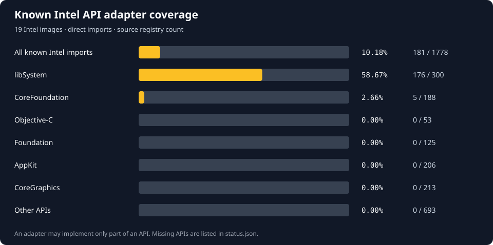

# Adapter

Runs selected Intel macOS binaries on Windows x64. Adapter loads the original
Mach-O code and supplies Darwin API adapters. Intel instructions run directly
on the CPU. ARM64 translation is not implemented.

[Build](#build-and-run) · [API coverage](#api-coverage) ·
[Working features](#what-works) · [Work to do](#work-to-do) ·
[Architecture](docs/architecture.md) · [Contributing](CONTRIBUTING.md)

## API coverage

<!-- API-COVERAGE:START -->

[](docs/progress/README.md)

**278 / 1,860 known Intel imports have adapters: 14.95%.**

This counts unique **(library install name, imported symbol)** pairs from
18 inspected Apple Intel images, jq 1.8.2 and ripgrep 15.2.0. It includes imported data.
An adapter may implement only part of an API. The percentage measures adapter
availability, not application compatibility or total macOS completion.
ARM64 and transitive dependencies are outside this count.

| Program | Direct imports with adapters | API coverage | Execution status |
| --- | ---: | ---: | --- |
| jq 1.8.2 | 136 / 136 | 100.00% | 14 recorded tests passed |
| ripgrep 15.2.0 | 131 / 131 | 100.00% | 11 recorded CLI tests passed |
| LogTool | 18 / 34 | 52.94% | Inspected; not run |
| Clipboard Viewer | 1 / 55 | 1.82% | Inspected; Objective-C/AppKit missing |
| Xcode 27 launcher | — | — | ARM64; no translator |
<!-- API-COVERAGE:END -->

[All 20 Intel images](docs/progress/README.md) ·
[Missing APIs by target](docs/progress/status.json) ·
[Recorded imports and hashes](docs/progress/imports.json)

Regenerate the counts after adding adapters:

```powershell
python tools/update_progress.py
```

This reads the source registries and committed import inventory. It does not
run a guest binary or require the Apple archives. Do not edit the chart by hand.
When adding a new target, see the inventory refresh command in
[the coverage notes](docs/progress/README.md).

## What works

| Area | Implemented behavior | Code / tests |
| --- | --- | --- |
| Inspection | Mach-O64 headers, FAT32/FAT64 selection, commands, sections, symbols and dependencies; `.app` executable discovery | [Inspector](src/inspect/mod.rs), [parser tests](tests/unit/macho.rs) |
| Intel loading | PIE executables, local dylibs, two-level exports/reexports, classic and supported chained fixups, constructors and teardown | [Loader](src/loader), [runtime](src/runtime), [integration tests](tests/integration/test_runtime.py) |
| Dynamic loading | Runtime `dlopen`/`dlsym`/`dlclose`/`dlerror` for classic and chained Intel dylibs and bundles; refcounted handles, `RTLD_LOCAL`/`GLOBAL`/`NOLOAD`/`FIRST` scope, per-image constructors/destructors and per-thread errors | [Dynamic registry](src/runtime/dynamic.rs), [dlfcn adapters](src/darwin/dl.rs), [plugin consumer](tests/fixtures/dlopen.c), [results](docs/dynamic-loading-results.md) |
| TLS and threads | Per-image/per-thread TLV storage, C++ thread-local destruction, create/join, keys/destructor passes, once, errno, condition variables with signal/broadcast/timedwait | [Darwin modules](src/darwin), [thread probes](tests/fixtures/thread_state.c), [results](docs/thread-lifecycle-results.md) |
| libc | C/POSIX rune data, separate Darwin FILE objects, binary I/O, printf-family varargs, UTF-8 paths/stat64, environment, selected time/string/math APIs | [Native adapters](src/darwin/host), [libc tests](tests/integration/test_libc.py) |
| Mach IPC | Simple messages between unchanged Mach-O processes through a loopback broker; receive/send/send-once rights, XNU header inversion, timeouts, LARGE retry, bootstrap check-in/lookup and retirement errors | [Mach adapter](src/darwin/mach.rs), [broker](src/broker), [fixtures](tests/fixtures/mach_server.c), [results](docs/mach-ipc-results.md) |
| CoreFoundation | Five functions for runtime-created UTF-8 strings, UTF-16 length and retain/release | [CF adapter](src/frameworks/corefoundation.rs), [consumer](tests/fixtures/corefoundation.c) |
| Real binary | Original jq: JSON pipelines, Unicode, regex, files/modules, dates, math, diagnostics and exit codes; pinned upstream jq.test passes 550/550 | [jq tests](tests/integration/test_jq.py), [results](docs/jq-libc-results.md) |
| Second real binary | Original ripgrep 15.2.0: recursive search, gitignore/hidden rules, JSON, PCRE2, UTF-8, stdin, binary detection, mmap, multithreaded search and exit codes | [ripgrep tests](tests/integration/test_ripgrep.py), [results](docs/ripgrep-results.md) |

**Test state:** the current run passed 118 distinct tests: 25 Rust, nine archive
and 84 integration tests. All 84 integration tests also passed in release. The
integration run includes the unmodified jq binary executing jq's pinned upstream
`tests/jq.test` suite with its module fixtures (550/550), the unmodified
ripgrep binary exercising 11 CLI workflows, and two unchanged Mach-O processes
exchanging Mach messages through the broker. This is Windows-side evidence; no
reference-Mac run exists.
[Current run](docs/test-results/latest.json) ·
[Summary](docs/test-results/summary.json).

## Work to do

| Work | Current gap | Start here | Needed evidence |
| --- | --- | --- | --- |
| Reference-Mac comparison | All runtime evidence is Windows-side; generated probes and jq outputs have not been compared with macOS | [Verifier](tools/verify.py), [current logs](docs/test-results/latest.json) | Same-artifact output and error comparisons on a real Mac |
| TLS lifecycle | In-process C++ TLV destruction works; shared-cache TLVs, `__cxa_thread_atexit` and exact Darwin destructor ordering are unverified | [TLS planning](src/loader/tls.rs), [TLV runtime](src/darwin/tlv.rs) | Shared-cache and cross-compiler consumers plus reference ordering |
| Synchronization | Condition variables work in-process; no cancellation, process-shared objects, errorcheck/adaptive mutexes or nondefault scheduling | [Sync adapters](src/darwin/sync.rs), [threads](src/darwin/threads.rs) | Cancellation/cleanup and cross-process lifetime tests |
| Dynamic loading | Runtime load works, but images are never unmapped; dynamic TLS and `@rpath` arguments are rejected, `RTLD_NEXT`/`RTLD_SELF` and `dladdr` are absent, and cross-group dependency sharing, interposition, ObjC registration and cyclic initialization are unsupported | [Dynamic registry](src/runtime/dynamic.rs), [roadmap D1](docs/roadmap.md) | True unload, TLS-bearing plugins, `RTLD_NEXT`/interposition and a pinned real plugin consumer |
| OS services | Mach ports, simple messages and a bootstrap table work across processes through `adapter-broker`; complex messages, `launchd` jobs, XPC and `fork`/`exec` are absent | [Roadmap D2-D4](docs/roadmap.md), [Mach results](docs/mach-ipc-results.md) | Complex-message and pinned real Mach consumers, a broker-spawned job, and a real libxpc consumer; none is implied by POSIX adapters |
| Objective-C | No class/selector registration, dispatch, ownership or class initialization | [Metadata probe](tests/fixtures/objc.m), [missing imports](docs/progress/status.json) | Execute a small Apple-ABI object/method consumer before trying an app |
| Frameworks and GUI | Foundation, AppKit and SwiftUI absent; CF limited to strings | [Framework adapters](src/frameworks), [Apple target inventory](docs/reverse-engineering/apple-inputs/targets.json) | Grow APIs from a chosen target; test object lifetime, resources, windows and events |
| libc completeness | Missing APIs and partial semantics: Unicode locales, cookie streams, wide/positional/long-double formatting, filesystem metadata, date formats and timezone behavior | [ABI adapters](src/darwin/host), [API contracts](docs/compatibility.md) | Focused Mach-O probes and same-artifact output/error comparisons |
| Exceptions and OS services | No Darwin unwinder, general signal model, syscall personality, Mach IPC, networking or fork/exec | [Runtime](src/runtime), [limitations](docs/limitations.md) | Separate consumers for each service and failure path |
| ARM64 and Xcode | ARM instructions cannot execute through the Intel loader; private frameworks/services also missing | [Xcode findings](docs/reverse-engineering/xcode27.md), [roadmap](docs/roadmap.md) | ARM64 execution first, then measured framework/service bring-up |

Choose a consumer from the missing-API inventory, implement the required
behavior and add a test.
`objc_msgSend` and related runtime imports occur in most inspected Apple apps;
adding more unrelated libc wrappers alone will not make those apps run.

## Build and run

Requires Windows x64, Rust's MSVC toolchain, Visual C++/Windows SDK build tools,
Python 3.12+, and LLVM with `clang`, `ld64.lld`, `llvm-ar` and `clang-format`.
The recorded environment used Rust 1.99.0 and LLVM 23.1.3. LLVM defaults to
`C:\Program Files\LLVM\bin`; override it with `ADAPTER_LLVM`.

```powershell
git clone https://github.com/Avaneesh-Inamdar/Adapter.git
cd Adapter
cargo build --locked
python tests/build_fixtures.py
python tools/fetch_jq.py
python tools/fetch_ripgrep.py
python tools/verify.py
```

Reference fetches are pinned by SHA-256. No Mac or Apple SDK is needed for the
test fixtures. Downloaded binaries and supplied Apple archives stay out of Git.

```powershell
target/debug/adapter-run.exe tests/fixtures/generated/reference/jq-macos-amd64 -- --version
'{"a":[1,2,3]}' | target/debug/adapter-run.exe tests/fixtures/generated/reference/jq-macos-amd64 -- -c '.a | map(. * 2)'

target/debug/adapter-inspect.exe --json tests/fixtures/generated/reference/jq-macos-amd64
target/debug/adapter-run.exe --check tests/fixtures/generated/reference/jq-macos-amd64

target/debug/adapter-run.exe tests/fixtures/generated/reference/ripgrep-macos-amd64 -- --version
printf 'alpha\nneedle here\n' | target/debug/adapter-run.exe tests/fixtures/generated/reference/ripgrep-macos-amd64 -- -n needle
```

`--check` performs static preflight; it does not execute or certify the program.
Put guest arguments after `--`. Guest exit codes are preserved; runtime errors
return 125. The worker timeout defaults to 10 seconds (`--timeout 1..3600`).
The worker has the user's process permissions; it is not a security sandbox.

Mach ports and bootstrap services are process-local unless a broker is running.
Start it once, then point each worker at its endpoint file:

```powershell
target\debug\adapter-broker.exe --endpoint broker.json
$env:ADAPTER_MACH_BROKER = (Resolve-Path broker.json).Path
```

The broker is a trusted local message router, not a security boundary, and it
does not spawn processes. A missing endpoint file makes `adapter-run` exit 125
before guest entry.

Guest paths `/C/Users/...` and `/E/...` map to Windows drives. Use that spelling
for jq `-L` module search paths so macOS code recognizes them as absolute.
Native Windows paths also work for ordinary file opens.
`--config FILE` accepts JSON `sysroot` and `library_paths` fields.

## Adding support

1. Pick a target from [the import inventory](docs/progress/status.json) and check
   its architecture and current loader blockers.
2. Find the missing behavior in the owning library. Guest calls use Darwin
   x86-64 SysV; host calls use Windows conventions. Translate structures and
   varargs explicitly; do not pass Darwin FILE/stat/tm/va_list objects to the CRT.
3. Add a Mach-O consumer under `tests/fixtures` or a pinned real-binary regression
   under `tests/integration`. Cover failure behavior as well as the successful call.
4. Run `python tools/verify.py`, update the [API contract](docs/compatibility.md),
   then run `python tools/update_progress.py` and commit the regenerated coverage.

[Detailed roadmap](docs/roadmap.md) · [Architecture](docs/architecture.md) ·
[Known limitations](docs/limitations.md) · [Contribution guide](CONTRIBUTING.md)

Source is [MIT licensed](LICENSE). External test artifacts retain their own
licenses. Adapter is independent of Apple, jq and ripgrep.
