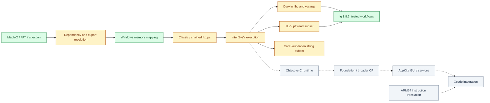

# Adapter

**Run selected Intel macOS executables on Windows through a native compatibility runtime.**

Adapter loads existing Mach-O machine code, resolves dylibs, translates Darwin
APIs and calls Intel code directly on Windows x64. The runtime engine and tools
currently use the **DarwinBridge** name: `db-inspect` and `db-run`.

**Current milestone:** the unchanged **jq 1.8.2 macOS amd64** executable runs on
Windows. Automated tests cover piped JSON, Unicode, regex, large streams, files,
modules, UTC dates, math, diagnostics and exit codes. Xcode and macOS GUI apps
remain future targets. No overall macOS compatibility percentage is claimed.

[Build & run](#build--run) · [Component map](#component-map) ·
[Compatibility](docs/compatibility.md) · [Roadmap](docs/roadmap.md) ·
[Architecture](docs/architecture.md) · [Contributing](CONTRIBUTING.md)

## Component map

**Verified** means the stated scope has passing tests. **Partial** means a tested
subset exists with known gaps. **Planned** means execution support is absent.
The map is inspired by the component/status presentation in
[AnyPS5](https://github.com/boykopovar/AnyPS5); the implementation is independent.



| Component | Status | Finished and tested | Remaining work |
| --- | --- | --- | --- |
| Mach-O inspector | Verified scope | Intel/ARM64 headers, FAT32/FAT64 selection, bounded commands/sections/symbols, 43 Apple images | Wider format corpus, dedicated fuzzing |
| Dependency resolver | Partial | Install names, sysroot/search paths, rpaths, bundles, two-level exports and reexports | Weak/flat/interposed binding, cyclic initialization, runtime `dlopen` |
| Windows loader | Verified scope | Bounded mapping, rebases/binds, W^X protections, cleanup | Broader executable/load-command forms |
| Modern dyld | Partial | Chained pointer formats 2/6, import formats 1/2, eager lazy binding | Multi-start pages, compressed symbols, other formats/resolvers |
| Intel ABI bridge | Partial | SysV entry/callbacks, integer/SSE arguments, stack spill, LP64 integers, printf-family varargs | General aggregates, wide/positional/long-double formatting, unwind integration |
| Process lifecycle | Partial | Dependency constructors, exit callbacks, DSO finalization, normal-return teardown, worker timeout | Full process/signal semantics, fork/exec |
| Darwin locale | Partial | C/POSIX locale, cached RuneLocale data and ASCII masks | Unicode/system locales and xlocale APIs |
| stdio and formatting | Partial | Separate Darwin `FILE` objects, standard streams, binary I/O, printf/fprintf/snprintf/vsnprintf | Full stdio surface, cookie streams, general buffering/locking |
| Memory/strings/math | Partial | jq's imported allocation/string/math adapters; 80-bit `nexttoward` argument bridge | Complete libc, errno/fenv equivalence and numerical edge corpus |
| Filesystem/environment/time | Partial | UTF-8 files, stat64 translation, drive paths, guest environment, UTC/time adapters | POSIX metadata fidelity, directory descriptors, full date formats/timezones |
| Darwin TLV/TLS | Partial | Initialized/zero/aligned templates, per-thread/per-image storage, GPR/SSE/AVX preservation | C++ TLV initialization/destruction, shared-cache TLVs |
| pthreads and errno | Partial | Create/join, identity, keys, destructor passes, once, per-thread errno | Mutexes/conditions, attributes, cancellation and cleanup |
| CoreFoundation | Partial | Five immutable UTF-8 string/ownership functions, UTF-16 length | Other CF types, constant strings, bridging |
| Objective-C | Planned | Metadata detection and rejection; target inspection | Classes/metaclasses, selectors, dispatch, ownership, initialization |
| Foundation / AppKit / SwiftUI | Planned | Dependency evidence only | Framework behavior, resources, windows and event loops |
| Darwin kernel services | Planned | Host API adapters for the tested libc slice | Syscall personality, Mach IPC, networking, security and device services |
| ARM64 execution | Planned | Static inspection and slice identification | Instruction translation plus ABI/TLS/exception integration |
| Xcode | Investigation | Archive inventory, selected extraction and launcher/tool dependency analysis | ARM64 execution, private frameworks, GUI, developer services |

## What works today

- [x] Inspect thin/universal Mach-O files and discover `.app` executables.
- [x] Execute Intel PIE programs and local dylib graphs with ordered lifecycle.
- [x] Apply classic and supported chained fixups with two-level symbol lookup.
- [x] Run TLS and pthread probes across eight threads and multiple images.
- [x] Bridge Darwin locale data, standard streams and SysV variadic formatting.
- [x] Run the original macOS jq executable through real JSON/file/module workflows.
- [x] Reproduce builds, lint checks and tests with retained verification logs.

An earlier milestone run passed **89 distinct tests** — 17 Rust tests,
9 archive tests and 63 integration tests — with all 63 integration tests also
passing against the release build. These include 13 jq tests and three libc ABI
tests; individual methods exercise several cases/fixture variants.

**Final local verification is blocked:** Windows Application Control denied
execution of test/runtime binaries (error 4551) after the final locale/FILE input
validation changes. Compilation and the available checks are recorded separately;
blocked launches are not counted as passes. Security policy was not changed.
See [the current run](docs/test-results/latest.json),
[the previous passing summary](docs/test-results/summary-previous-pass.json) and
[the jq/libc milestone](docs/jq-libc-results.md).

## Compatibility

| Target | Observed result | Boundary |
| --- | --- | --- |
| jq 1.8.2, published macOS amd64 | Runs tested CLI workflows on Windows | Hash-pinned original artifact; no reference-Mac comparison or full jq-suite claim |
| Generated Intel Mach-O probes | Execute classic/chained/dylib/TLS/libc cases | SDK-free test consumers; not production apps |
| CoreFoundation string consumer | Executes UTF-8/UTF-16 and ownership checks | Runtime-created strings only |
| Xcode 27 and sampled command-line tools | Static analysis only | Sampled launcher/tools are ARM64-only |
| Additional Tools / Icon Composer | Static inspection of Intel/ARM slices | Objective-C/framework/UI prerequisites remain |

`--check` validates the supported loader plan and import bindings. It does not
execute the program or certify every API path. The worker isolates crashes and
timeouts; it has the user's process permissions and is not a security sandbox.

## Build & run

Requirements: Windows x64, Rust's MSVC toolchain and Visual C++/Windows SDK build
tools, Python 3.12+, and LLVM with `clang`, `ld64.lld` and `llvm-ar`. This milestone
was tested with Rust 1.99.0, Python 3.12 and LLVM 23.1.3. LLVM defaults to
`C:\Program Files\LLVM\bin`; set `DARWINBRIDGE_LLVM` to use another directory.

```powershell
git clone https://github.com/Avaneesh-Inamdar/Adapter.git
cd Adapter
cargo build --locked
python tests/build_fixtures.py
python tools/fetch_jq.py
python tools/verify.py
```

The first reference fetch downloads one public jq release asset and checks its
fixed SHA-256. Subsequent runs verify the cached file. Apple SDKs and a Mac are
not required to build the probe executables. No Apple binaries are distributed.

```powershell
# Inspect and preflight without executing.
target/debug/db-inspect.exe --json tests/fixtures/generated/reference/jq-macos-amd64
target/debug/db-run.exe --check tests/fixtures/generated/reference/jq-macos-amd64

# Execute the original Intel macOS jq.
target/debug/db-run.exe tests/fixtures/generated/reference/jq-macos-amd64 -- --version
'{"a":[1,2,3]}' | target/debug/db-run.exe tests/fixtures/generated/reference/jq-macos-amd64 -- -c '.a | map(. * 2)'

# Trace a transitive dylib consumer.
target/debug/db-run.exe --trace tests/fixtures/generated/dylibs/chained/multi
```

Use `--` before guest arguments. Guest exit codes are preserved; runtime errors
return 125. The default worker timeout is 10 seconds (`--timeout 1..3600`).
Standard input is inherited and guest streams preserve binary bytes.

For absolute paths used inside POSIX consumers, `/C/Users/...` maps to
`C:\Users\...`; `/E/...` maps to drive E. Canonical paths use this spelling so
unchanged macOS code recognizes them as absolute. Native Windows paths also
work for ordinary file opens. Use the `/C/...` spelling for jq `-L` module paths.

Optional `--config FILE` JSON accepts `sysroot` and `library_paths`, for example
`{"sysroot":"E:/macos-root","library_paths":[]}`. See
[the precise support contracts](docs/compatibility.md) and
[known limitations](docs/limitations.md).

## Next milestones

1. Expand the real binary corpus and add reference-Mac output/error comparisons.
2. Complete C++ TLV lifecycle, required pthread synchronization and runtime dylib loading.
3. Bring up a minimal Apple Objective-C metadata/dispatch consumer.
4. Grow CoreFoundation/Foundation from measured target imports, then AppKit GUI behavior.
5. Develop ARM64 translation and Xcode's private-framework/service integration as separate workstreams.

The [roadmap](docs/roadmap.md) lists concrete acceptance gates. Completed probe
coverage is retained as a regression requirement for every phase.

## Repository layout

| Path | Purpose |
| --- | --- |
| `src/inspect` | Mach-O metadata and command-line inspector |
| `src/loader` | Dependency graph, exports, fixups and TLS planning |
| `src/runtime`, `src/platform` | Worker execution and Windows memory ownership |
| `src/darwin` | SysV adapters, thread state and native libc ABI bridge |
| `src/frameworks` | Measured framework subsets |
| `tests` | Mach-O builders, ABI probes, negative tests and real jq workflows |
| `tools` | Verification, pinned artifact fetch and read-only archive analysis |
| `docs` | Architecture, support contracts, findings, roadmap and retained results |

User-provided archives stay under ignored `req files/`; extraction outputs and
analysis tools stay under ignored `target/`. Raw extracted data forks may be
filesystem-compression placeholders; reports identify that limitation. See
[Xcode evidence](docs/reverse-engineering/xcode27.md) and
[jq ABI evidence](docs/reverse-engineering/jq-libc-abi.md).

## Contributing and license

Read [CONTRIBUTING.md](CONTRIBUTING.md) for build checks and the evidence expected
for compatibility claims. Adapter is an early interoperability project with no
release package yet. Source is [MIT licensed](LICENSE); external test artifacts
remain under their respective licenses. Adapter is independent of Apple and jq.
