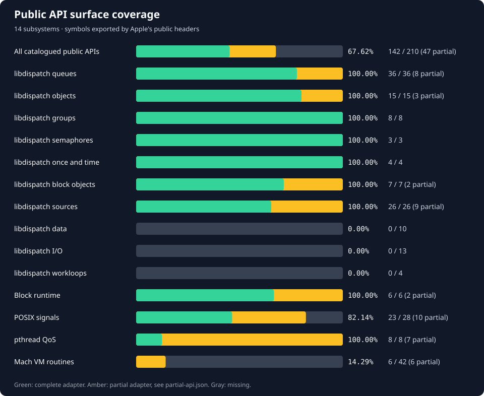
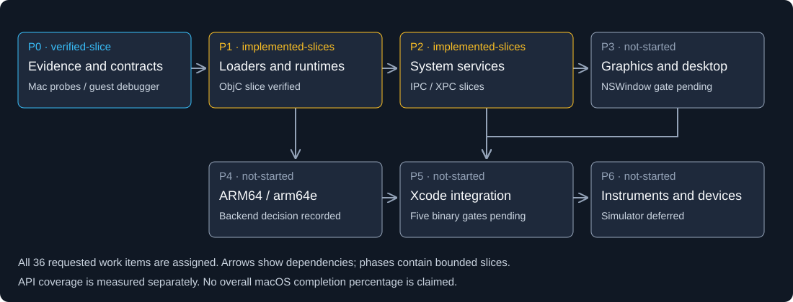

# Adapter

Runs selected Intel macOS binaries on Windows x64. Adapter loads the original
Mach-O code and supplies Darwin API adapters. Intel instructions run directly
on the CPU. ARM64 translation is not implemented.

[Build](#build-and-run) · [API coverage](#api-coverage) ·
[Phases](#delivery-phases) · [Working features](#what-works) · [Work to do](#work-to-do) ·
[Architecture](docs/architecture.md) · [Contributing](CONTRIBUTING.md)

## API coverage

<!-- API-COVERAGE:START -->

[](docs/progress/README.md)

**328 / 1,860 known Intel imports have adapters: 17.63%.**

This counts unique **(library install name, imported symbol)** pairs from
18 inspected Apple Intel images, jq 1.8.2 and ripgrep 15.2.0. It includes imported data.
An adapter may implement only part of an API. The percentage measures adapter
availability, not application compatibility or total macOS completion.
ARM64 and transitive dependencies are outside this count.

| Program | Direct imports with adapters | API coverage | Execution status |
| --- | ---: | ---: | --- |
| jq 1.8.2 | 136 / 136 | 100.00% | 14 recorded tests passed |
| ripgrep 15.2.0 | 131 / 131 | 100.00% | 11 recorded CLI tests passed |
| LogTool | 25 / 34 | 73.53% | Inspected; not run |
| Clipboard Viewer | 11 / 55 | 20.00% | Inspected; framework classes/AppKit missing |
| Xcode 27 launcher | — | — | ARM64; no translator |
<!-- API-COVERAGE:END -->

<!-- PUBLIC-API:START -->

[](docs/progress/README.md#public-api-surface)

**239 / 432 catalogued public APIs have adapters: 55.32% (66 of them partial).**

The chart above counts only what the inspected binaries import. This one counts every symbol
in the selected public headers catalogued here (libdispatch, the Block
runtime, signals, pthread QoS, Mach VM, sysctl, libproc, posix_spawn and process control), pinned
to Apple open-source commits. Adding a subsystem
to the catalog is a small change in `tools/extract_public_api.py`.
<!-- PUBLIC-API:END -->

[All 20 Intel images](docs/progress/README.md) ·
[Missing APIs by target](docs/progress/status.json) ·
[Recorded imports and hashes](docs/progress/imports.json)

Regenerate the counts after adding adapters:

```powershell
python tools/update_progress.py
```

This reads the source registries and committed import inventory. It does not
run a guest binary or require the Apple archives. Do not edit the chart by hand.
When adding a new target, see the inventory refresh command in
[the coverage notes](docs/progress/README.md).

## What works

| Area | Implemented behavior | Code / tests |
| --- | --- | --- |
| Inspection | Mach-O64 headers, FAT32/FAT64 selection, commands, sections, symbols and dependencies; `.app` executable discovery | [Inspector](src/inspect/mod.rs), [parser tests](tests/unit/macho.rs) |
| Intel loading | PIE executables, local dylibs, two-level exports/reexports, classic and supported chained fixups, constructors and teardown | [Loader](src/loader), [runtime](src/runtime), [integration tests](tests/integration/test_runtime.py) |
| Dynamic loading | Runtime `dlopen`/`dlsym`/`dlclose`/`dlerror` for classic and chained Intel dylibs and bundles; refcounted handles, `RTLD_LOCAL`/`GLOBAL`/`NOLOAD`/`FIRST` scope, per-image constructors/destructors and per-thread errors | [Dynamic registry](src/runtime/dynamic.rs), [dlfcn adapters](src/darwin/dl.rs), [plugin consumer](tests/fixtures/dlopen.c), [results](docs/dynamic-loading-results.md) |
| TLS and threads | Per-image/per-thread TLV storage, C++ thread-local destruction, create/join, keys/destructor passes, once, errno, condition variables with signal/broadcast/timedwait | [Darwin modules](src/darwin), [thread probes](tests/fixtures/thread_state.c), [results](docs/thread-lifecycle-results.md) |
| libc | C/POSIX rune data, separate Darwin FILE objects, binary I/O, printf-family varargs, UTF-8 paths/stat64, environment, selected time/string/math APIs | [Native adapters](src/darwin/host), [libc tests](tests/integration/test_libc.py) |
| Mach IPC | Simple messages between unchanged Mach-O processes through a loopback broker; receive/send/send-once rights, XNU header inversion, timeouts, LARGE retry, bootstrap check-in/lookup and retirement errors | [Mach adapter](src/darwin/mach.rs), [broker](src/broker), [fixtures](tests/fixtures/mach_server.c), [results](docs/mach-ipc-results.md) |
| launchd jobs | Broker loads launchd-style plists, reserves `MachServices` names and starts registered jobs on first lookup or `RunAtLoad`; environment and log redirection, check-in wait, respawn after exit | [job parser](src/broker/job.rs), [broker activation](src/broker/main.rs), [results](docs/launchd-results.md) |
| XPC | Unchanged libxpc client/server processes exchange typed dictionary messages and replies through the broker; listener check-in, demand spawn, accepted peers, event-handler blocks, typed containers, connection invalidation/interruption | [XPC adapter](src/darwin/xpc.rs), [server](tests/fixtures/xpc_server.c), [client](tests/fixtures/xpc_client.c), [results](docs/xpc-results.md) |
| Objective-C | Raw-isa metadata, categories, protocols/properties, message dispatch, runtime-owned ARC/MRC strong and zeroing weak references, inherited ivar cleanup, custom RR and explicit pools | [Runtime](src/objc), [ABI contract](docs/abi/objc-abi.md), [ARC results](docs/arc-results.md), [other results](docs/objc-results.md) |
| Guest debugging | Windows LLDB captures actual exceptions, relocated Mach-O PCs, registers, disassembly and stacks; VM-address breakpoints and instruction stepping | [Debugger](tools/guest_debug.py), [usage and limits](docs/guest-debugging.md) |
| Unwind-section discovery | dyld image/header/path queries locate mapped compact-unwind and DWARF sections in startup images and runtime plugins; no frame walking or exception propagation yet | [dyld adapters](src/darwin/dyld.rs), [consumers and results](docs/unwind-results.md) |
| CoreFoundation | Five functions for runtime-created UTF-8 strings, UTF-16 length and retain/release | [CF adapter](src/frameworks/corefoundation.rs), [consumer](tests/fixtures/corefoundation.c) |
| Grand Central Dispatch | Serial/concurrent/root/main queues, sync and async submission, barriers, target queues, suspension and inactive queues, groups, `dispatch_once`, `after`, `apply`, block objects (`wait`/`notify`/`cancel`), timer and user-data sources, queue-specific data, finalizers; `_Block_object_assign`/`dispose` so `__block` variables and captured blocks survive copying | [Dispatch](src/darwin/dispatch.rs), [block objects](src/darwin/dispatch/block_objects.rs), [sources](src/darwin/dispatch/sources.rs), [consumers](tests/fixtures/dispatch.c), [sources consumer](tests/fixtures/dispatch_source.c), [results](docs/dispatch-results.md) |
| sysctl and libproc | `sysctl`, `sysctlbyname` and `sysctlnametomib` answer about 75 `kern`/`hw`/`machdep`/`user`/`vm` names from host facts (processors, caches, memory, CPUID, boot time) and fixed Darwin 24.6 values that agree with `uname`; size queries, short buffers, read-only and error rules follow `sysctl(3)`; `libproc` describes the guest's own process | [sysctl adapter](src/darwin/sysctl.rs), [consumer](tests/fixtures/sysctl.c), [results](docs/sysctl-results.md) |
| pthread QoS | Classes and relative priorities recorded per thread and attribute; no scheduling effect | [QoS adapter](src/darwin/qos.rs), [consumer](tests/fixtures/qos.c) |
| Signals | Synchronous Darwin signals for the calling thread: `signal`/`sigaction` dispositions, `sigprocmask`/`pthread_sigmask`, `sigset_t` helpers, `raise`/`kill`/`killpg` on the guest pid, pending sets and `sigwait`, `sa_mask` and default termination (`128 + signal`) | [Signal adapter](src/darwin/signal.rs), [consumer](tests/fixtures/signals.c), [default action](tests/fixtures/signals_default.c), [results](docs/signal-results.md) |
| Real binary | Original jq: JSON pipelines, Unicode, regex, files/modules, dates, math, diagnostics and exit codes; pinned upstream jq.test passes 550/550 | [jq tests](tests/integration/test_jq.py), [results](docs/jq-libc-results.md) |
| Second real binary | Original ripgrep 15.2.0: recursive search, gitignore/hidden rules, JSON, PCRE2, UTF-8, stdin, binary detection, mmap, multithreaded search and exit codes | [ripgrep tests](tests/integration/test_ripgrep.py), [results](docs/ripgrep-results.md) |

**Test state:** the current run passed 192 distinct tests: 32 Rust, 30 archive
and 130 integration tests. All 130 integration tests also passed in release. The
integration run includes the unmodified jq binary executing jq's pinned upstream
`tests/jq.test` suite with its module fixtures (550/550), the unmodified
ripgrep binary exercising 11 CLI workflows, two unchanged Mach-O processes
exchanging Mach messages through the broker, a broker-started launchd-style
job reached by the same unchanged client, an unchanged libxpc client/server
pair exchanging typed dictionary messages and replies, the Objective-C class and
category consumers in classic, chained and relative fixup forms, and nine Windows
LLDB guest-debugging cases. This is
Windows-side evidence; the only reference-Mac executions are the hosted
4,096-case libc [differential run](docs/differential-testing.md#recorded-run-2026-10-22),
the 4,096-case Objective-C
[differential run](docs/differential-testing.md#recorded-objective-c-run-2026-10-22)
, the 1,024-case threading
[differential run](docs/differential-testing.md#recorded-threading-run-2026-10-22)
and the 30-case jq/ripgrep
[CLI differential](docs/differential-testing.md#recorded-cli-run-2026-10-22), plus
4,096 protocol/property comparisons in the
[metadata differential](docs/differential-testing.md#recorded-objective-c-metadata-run-2026-10-22).
The [ARC/weak run](docs/arc-results.md) adds 1,024 comparisons at each compiler
optimization level (`-O0`, `-O2`), matching in debug and release.
Two [unwind-discovery suites](docs/unwind-results.md) add 1,024 comparisons each
for compact and DWARF-fallback executables, also matching in both builds.
[Current run](docs/test-results/latest.json) ·
[Summary](docs/test-results/summary.json).

## Delivery phases

[](docs/phases.md)

All **36 requested work items** are assigned in the [phase work list](docs/phases.md).
The graph records dependencies and implemented slices. The API percentage above
uses a measured import inventory; it is not a percentage of macOS completed.

| Phase | Scope | Current state |
| --- | --- | --- |
| P0 | Mac reference, differential probes, guest debugging, ABI contracts | First 4,096-case Mac comparison matches in debug and release; nine debugger tests pass in both profiles; expand coverage per subsystem |
| P1 | Shared cache, Objective-C, Swift, unwind, Mach VM | Intel loader, runtime-owned ARC/weak references, dyld unwind-section discovery and Mach VM slices work; shared cache, Swift and frame unwinding remain |
| P2 | GCD, Foundation, runloops, IPC, XPC, launchd, processes, daemons, signals | Simple IPC, job, XPC, synchronous signal, GCD and sysctl slices work; broader system behavior remains |
| P3 | Graphics, IOSurface, Metal, AppKit, SwiftUI, WindowServer | Not started |
| P4 | ARM64 backend, 16K pages, memory ordering, arm64e | Native Windows ARM64 preferred when hardware is available; no ARM execution yet |
| P5 | Debugserver primitives, signing/keychain, tool/SDK paths, Xcode | Not started; all five application gates pending |
| P6 | Instruments, devices, Simulator | Not started; Simulator deferred |

The application gates are binary pass/fail: **NSWindow hello-world → xcodebuild →
Xcode welcome window → open project → build project**. None has passed.
See [acceptance criteria](docs/phases.md#binary-acceptance-gates),
[versioned ABI contracts](docs/abi/README.md) and the
[upstream source catalog](docs/upstream-sources.md) for implementation starting points.
The catalog distinguishes reusable code from Apple-dependent implementations and
private components for which no complete public implementation was found.

## Work to do

| Work | Current gap | Start here | Needed evidence |
| --- | --- | --- | --- |
| Reference-Mac comparison | Hosted Intel Mac libc differential passes 4,096/4,096 in debug and release; Objective-C, threading, jq/ripgrep and service ordering still need reference captures | [Harness](tools/differential.py), [reference workflow](.github/workflows/mac-reference.yml), [results](docs/differential-testing.md#recorded-run-2026-10-22) | Extend same-artifact probes and retain OS, hashes and failure details |
| TLS lifecycle | In-process C++ TLV destruction works; shared-cache TLVs, `__cxa_thread_atexit` and exact Darwin destructor ordering are unverified | [TLS planning](src/loader/tls.rs), [TLV runtime](src/darwin/tlv.rs) | Shared-cache and cross-compiler consumers plus reference ordering |
| Synchronization | Condition variables work in-process; no cancellation, process-shared objects, errorcheck/adaptive mutexes or nondefault scheduling | [Sync adapters](src/darwin/sync.rs), [threads](src/darwin/threads.rs) | Cancellation/cleanup and cross-process lifetime tests |
| Dynamic loading | Runtime load works, but images are never unmapped; dynamic TLS and `@rpath` arguments are rejected, `RTLD_NEXT`/`RTLD_SELF` and `dladdr` are absent, and cross-group dependency sharing, interposition, ObjC registration and cyclic initialization are unsupported | [Dynamic registry](src/runtime/dynamic.rs), [roadmap D1](docs/roadmap.md) | True unload, TLS-bearing plugins, `RTLD_NEXT`/interposition and a pinned real plugin consumer |
| OS services | Mach ports, simple messages, a bootstrap table, broker-started launchd-style jobs and simple XPC connections work across processes; complex messages, launchd supervision/`launchctl`, XPC beyond the typed dictionary subset and `fork`/`exec` are absent | [Roadmap D2-D5](docs/roadmap.md), [Mach results](docs/mach-ipc-results.md), [launchd results](docs/launchd-results.md), [XPC results](docs/xpc-results.md) | Complex-message and pinned real Mach consumers, launchd supervision/KeepAlive and socket activation, and XPC interoperability with a real macOS peer; none is implied by POSIX adapters |
| Objective-C | Runtime-owned ARC/MRC, weak references and metadata queries work; ARC Blocks, foreign objects, atomic/copy properties, dynamic registration, exceptions and aggregate/x87 sends remain | [ABI contract](docs/abi/objc-abi.md), [ARC results](docs/arc-results.md), [missing imports](docs/progress/status.json) | Add each lifetime/image extension with positive, rejection and native Mac probes |
| Frameworks and GUI | Foundation, AppKit and SwiftUI absent; CF limited to strings | [Framework adapters](src/frameworks), [Apple target inventory](docs/reverse-engineering/apple-inputs/targets.json) | Grow APIs from a chosen target; test object lifetime, resources, windows and events |
| libc completeness | Missing APIs and partial semantics: Unicode locales, cookie streams, wide/positional/long-double formatting, filesystem metadata, date formats and timezone behavior | [ABI adapters](src/darwin/host), [API contracts](docs/compatibility.md) | Focused Mach-O probes and same-artifact output/error comparisons |
| Grand Central Dispatch | Queues, groups, block objects and timer/user-data sources work; 8 source types (descriptor, process, signal, Mach, vnode, memory pressure), `dispatch_data`, `dispatch_io`, workloops and QoS scheduling are absent | [Dispatch results](docs/dispatch-results.md), [public-API gaps](docs/progress/README.md#public-api-surface) | Kernel-event-backed sources with consumers, then a reference-Mac comparison of ordering and coalescing |
| Process creation | `fork`, `exec*`, `posix_spawn` and `waitpid` are registered only to fail with `ENOSYS`/`ECHILD`; spawn attributes and file actions are recorded but never applied. 39 of 53 catalogued spawn and process-control symbols are absent | [Public-API gaps](docs/progress/README.md#public-api-surface), [spawn stubs](src/darwin/host/system.c) | `posix_spawn` and `execve` over a re-entered Adapter instance, descriptor and environment inheritance, `waitpid` of real children |
| Exceptions and OS services | No Darwin unwinder, asynchronous/per-thread signals, `siginfo`, fault-to-signal mapping, syscall personality, complex Mach messages, networking or fork/exec | [Runtime](src/runtime), [limitations](docs/limitations.md) | Separate consumers for each service and failure path |
| ARM64 and Xcode | ARM instructions cannot execute through the Intel loader; private frameworks/services also missing | [Xcode findings](docs/reverse-engineering/xcode27.md), [roadmap](docs/roadmap.md) | ARM64 execution first, then measured framework/service bring-up |

**What the public-API catalog shows.** Counting every symbol in the public headers
(not just what the 18 inspected binaries import) puts the subsystems built so far
at 239 of 432 symbols with an adapter, 66 of them partial or always failing. The
largest gaps are `dispatch_data`, `dispatch_io` and workloops (0 of 27), 36 of 42
Mach VM routines (region queries, read/write/copy, remap), 39 of 53 process-control
and spawn symbols, 60 of 135 `sysctl` names, 26 of 31 `libproc` calls and 5 of 28
signal calls. Those are the largest measurable gaps.

Choose a consumer from the missing-API inventory, implement the required
behavior and add a test.
`objc_msgSend` and related runtime imports occur in most inspected Apple apps.
The bounded dispatcher now exists; those apps still require additional metadata,
frameworks and services before they can execute.

## Build and run

Requires Windows x64, Rust's MSVC toolchain, Visual C++/Windows SDK build tools,
Python 3.12+, and LLVM with `clang`, `ld64.lld`, `llvm-ar` and `clang-format`.
The recorded environment used Rust 1.99.0 and LLVM 23.1.3. LLVM defaults to
`C:\Program Files\LLVM\bin`; override it with `ADAPTER_LLVM`.

```powershell
git clone https://github.com/Avaneesh-Inamdar/Adapter.git
cd Adapter
cargo build --locked
python tests/build_fixtures.py
python tools/fetch_jq.py
python tools/fetch_ripgrep.py
python tools/verify.py
```

Reference fetches are pinned by SHA-256. No Mac or Apple SDK is needed for the
test fixtures. Downloaded binaries and supplied Apple archives stay out of Git.

```powershell
target/debug/adapter-run.exe tests/fixtures/generated/reference/jq-macos-amd64 -- --version
'{"a":[1,2,3]}' | target/debug/adapter-run.exe tests/fixtures/generated/reference/jq-macos-amd64 -- -c '.a | map(. * 2)'

target/debug/adapter-inspect.exe --json tests/fixtures/generated/reference/jq-macos-amd64
target/debug/adapter-run.exe --check tests/fixtures/generated/reference/jq-macos-amd64

target/debug/adapter-run.exe tests/fixtures/generated/reference/ripgrep-macos-amd64 -- --version
printf 'alpha\nneedle here\n' | target/debug/adapter-run.exe tests/fixtures/generated/reference/ripgrep-macos-amd64 -- -n needle
```

`--check` performs static preflight; it does not execute or certify the program.
Put guest arguments after `--`. Guest exit codes are preserved; runtime errors
return 125. The worker timeout defaults to 10 seconds (`--timeout 1..3600`).
The worker has the user's process permissions; it is not a security sandbox.

Mach ports and bootstrap services are process-local unless a broker is running.
Start it once, then point each worker at its endpoint file:

```powershell
target\debug\adapter-broker.exe --endpoint broker.json
$env:ADAPTER_MACH_BROKER = (Resolve-Path broker.json).Path
```

Pass `--job job.plist` to register a launchd-style job. A lookup for one of its
`MachServices` names starts `adapter-run` with the job's program, arguments,
environment and log paths; `RunAtLoad` starts it when the broker loads. The
broker is a trusted local message, job and XPC router, not a security boundary
and not launchd: there is no `launchctl`, `KeepAlive`, supervision or socket
activation, and XPC is an Adapter-defined transport between workers rather than
Apple's wire format. A missing endpoint file makes `adapter-run` exit 125 before
guest entry. See [launchd results](docs/launchd-results.md) and
[XPC results](docs/xpc-results.md).

Guest paths `/C/Users/...` and `/E/...` map to Windows drives. Use that spelling
for jq `-L` module search paths so macOS code recognizes them as absolute.
Native Windows paths also work for ordinary file opens.
`--config FILE` accepts JSON `sysroot` and `library_paths` fields.

## Adding support

1. Pick a target from [the import inventory](docs/progress/status.json) and check
   its architecture and current loader blockers.
2. Find the missing behavior in the owning library. Guest calls use Darwin
   x86-64 SysV; host calls use Windows conventions. Translate structures and
   varargs explicitly; do not pass Darwin FILE/stat/tm/va_list objects to the CRT.
3. Add a Mach-O consumer under `tests/fixtures` or a pinned real-binary regression
   under `tests/integration`. Cover failure behavior as well as the successful call.
4. Update the owning [ABI contract](docs/abi/README.md), run `python tools/verify.py`,
   then run `python tools/update_progress.py` and commit the regenerated coverage.
   Update [phase states](docs/phases.json) only when their recorded evidence changes.

[Detailed roadmap](docs/roadmap.md) · [Architecture](docs/architecture.md) ·
[Known limitations](docs/limitations.md) · [Contribution guide](CONTRIBUTING.md)

Source is [MIT licensed](LICENSE). External test artifacts retain their own
licenses. Adapter is independent of Apple, jq and ripgrep.
